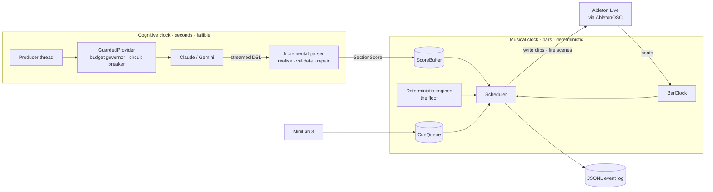

# GARAGEM

**A rock band made of agents.** One of them is a language model, and it is the songwriter: it
writes the songs before the show and is not in the room when they are played. Five are
deterministic engines, and they are the players: a drummer, a bassist, two guitarists, an
organist and a lead who sings the tune. The last one is a person, who chooses what stays in the
setlist and conducts the band from a MIDI controller or a keyboard. They play section by
section, live in Ableton Live, and on stage no network is needed.

**This is V2: the band got a studio.** V1 could play. V2 can be asked for a song: say what
kind, and the songwriter writes it; listen, and send the chorus back with a note; approve it,
and it is in the show. Two rooms, one for preparing the concert and one for playing it, and a
person at the door of each.

```
> new desert "slow, and mean"
5. Untitled 1: desert, F#m, straight8, 110 BPM. Change anything, then compose 5.
> title 5 "Smoking and Driving"
> compose 5
to write Smoking and Driving: 8 call(s) to claude-opus-5-5, about $0.52 ... Type yes to go ahead.
> yes
> listen 5
> approve 5
5. Smoking and Driving: approved. The show plays: Smoking and Driving.
```

[](https://github.com/fbattaglin/garagem-music/actions/workflows/ci.yml)


---

## Contents

- [The band](#the-band)
- [What it does](#what-it-does)
- [How it works](#how-it-works)
- [Design invariants](#design-invariants)
- [Getting started](#getting-started)
- [Preparing the show](#preparing-the-show)
- [Conducting from the MiniLab 3](#conducting-from-the-minilab-3)
- [Development](#development)
- [Project layout](#project-layout)
- [Status and roadmap](#status-and-roadmap)
- [Documentation](#documentation)

## The band

Nobody in it does another's job, and that is the design.

| Who | What they are | What they do |
|---|---|---|
| The songwriter | a frontier model (Claude Opus 5.5), offline | writes each song's riff and its two melodies, then every section with them in hand, in the style it is told |
| The arranger | a deterministic engine | decides the form: where the verse, the chorus, the bridge and the solo go, and how the song ends |
| The drummer | a deterministic engine | grooves by feel, opens the hats in a chorus, fills into what comes next |
| The bassist | a deterministic engine | holds the root on the low strings and walks when the tension rises |
| The guitarists | two deterministic engines | power chords, palm-muted in a verse and ringing in a chorus, where the second guitar doubles the first, panned apart |
| The organist | a deterministic engine | rests in a verse and holds the chord under a chorus |
| The lead | a deterministic engine | sings a verse tune and a higher chorus tune, and takes the solo |
| The producer | a thread | asks the songwriter ahead of time, and never makes the band wait for an answer |
| The conductor | a person | cues the band on the next bar, shapes its energy, and keeps or vetoes what it hears |

The players are called the *floor*: whatever the songwriter did not write, or wrote badly, they
play anyway. A language model that misses its entrance changes who wrote the next section,
never whether there is one.

## What it does

- **Plays live, on the bar.** Each section of a song is written into Live just before it is
  needed and launched by Live's own transport, through
  [AbletonOSC](https://github.com/ideoforms/AbletonOSC).
- **Splits the work by strength.** Deterministic engines, called the *floor*, play every
  section and compose the form: arrangement, builds, stops, fills and the final chord. A
  frontier model (Anthropic Claude) writes songs ahead of time into a *setlist*, which plays
  from disk with no network.
- **Takes curation while it plays.** Two pads keep or veto the section sounding, blind to who
  wrote it, and the marks are written back into the setlist.
- **Never falls silent.** Whatever the setlist does not hold, the floor plays. The model can
  still write live (`--generate`), and then a late answer or a dropped connection changes who
  wrote the next section, never whether it plays.
- **Takes direction from a human.** Pads on an Arturia MiniLab 3 cue the band on the next bar,
  and knobs shape the energy and tension of the sections still to come. Every cue has a word
  that can be typed instead, and a screen says where it will land.
- **Sounds like a band it borrowed.** The guitars, the bass and the kit are GarageBand's own
  samples, rebuilt as Live presets by code. Nothing is downloaded and nothing is installed.
- **Says whether it is ready.** One command checks Live, the Set, the controller and the
  setlist, and lists every problem at once, each with the step that fixes it.
- **Measures itself.** Every decision, fallback, cue and write goes into a JSONL event log
  with its beat and its seed. Any performance can be audited and replayed.

**Measured, not assumed** (`docs/architecture/phase-4-findings.md`,
`phase-5-findings.md`, `phase-8-findings.md`, `phase-9-findings.md`):

| | |
|---|---|
| An 8-minute conducted performance | 489 s continuous, 0 beats lost, 34 of 34 cues on the next bar, $0.24 |
| Chaos test: Wi-Fi lost twice mid-song | 0 beats lost, and nothing audible to the listener |
| A baked setlist | 3 songs written for $0.06, played from disk with no network or key |
| The show's setlist | 4 songs at 4 tempos and 4 feels, 24 of 24 sections delivered, written for $0.40 |
| The first songs asked for in the studio | 3 songs in 3 styles, 19 of 19 sections and 3 of 3 themes delivered, $1.55 |
| The songwriter copying its prompt's example | the example's kick in 3 of 152 drum bars, down from 99 of 192 |
| Model output, recorded regression set | 29 of 29 sections conformant, none needing repair |
| Test suite | 3,500 tests, network-free by construction, `mypy --strict` clean |

**Heard, not assumed.** A musical change passes on a short listen, and the verdict is quoted
as it was said ([ADR-019](docs/architecture/ADR-019-the-ear-is-the-instrument.md)). On the
band's sound: *"foi agradável e tinha um swag"*, and, once the guitars were panned, *"Sim. Está
mais arena"*. On the stage: *"Gostei muito das informacoes da tela. Foi pratico digitar sim"*.
On the first songs written in the studio: *"Tudo que compus e escutei até agora achei muito
bom. Um salto comparado com V1."*

## How it works

GARAGEM runs on two clocks that never call each other. Live owns the musical clock, which
must not jitter. Python and the model API own the cognitive clock, which takes seconds and
sometimes fails. A data structure, the `ScoreBuffer`, is the only thing that crosses between
them.



1. **Plan.** A song form is arranged from a seed, as a sequence of sections, each with a key,
   feel, tempo, dynamics and tension. It lives in a shared, versioned `FormPlan`.
2. **Ask ahead.** The producer thread briefs the model on the next section it can still serve,
   with a strict tool schema and a deadline taken from the section's length. The response is
   parsed as it streams, realised into notes, checked by a music-theory validator and
   repaired. Only then is it offered to the buffer.
3. **Write ahead.** During the first bar of section *N*, the scheduler writes section *N+1*
   into a scene that is not playing. It uses the model's score if one is ready and the
   floor's otherwise, and logs which with its seed.
4. **Let Live keep time.** The scheduler fires the next scene a bar early, and Live's
   launch quantisation performs the switch on the downbeat. No clip that is playing is ever
   rewritten.
5. **Conduct.** A pad strike only fires material that was written before it could be needed
   ([ADR-022](docs/architecture/ADR-022-a-cue-costs-a-fire-never-a-write.md)). A cue costs
   a fire, never a write, which is why it lands on the next bar. After a jump the form is
   re-planned deterministically, and the model is asked again about the new song.

## Design invariants

These are non-negotiable, and most are enforced by tests rather than by convention.

1. **Two clocks.** The musical and cognitive clocks are separated by a data structure, never
   by a function call. An architecture test forbids the real-time packages from importing the
   LLM layer.
2. **The system plays without a network.** Every path that uses a model has a local
   deterministic counterpart. An API failure degrades the music; it never silences it.
3. **No network, allocation or JSON on the real-time path.**
4. **Never trust model output.** A strict schema, then a deterministic musical validator.
5. **Never retry on the critical path.** A retry is a planning decision, not an execution
   one.
6. **Timing is Live's problem.** Clips are written into the next scene, and launch
   quantisation switches them. A playing clip is never rewritten.
7. **Every generation is deterministic given a seed,** and every seed is logged.

## Getting started

### Requirements

| | |
|---|---|
| Python | 3.12, managed with [uv](https://docs.astral.sh/uv/) |
| Ableton Live | 12 (Lite is enough: 5 or 6 of its 8 tracks and 8 scenes are used), with AbletonOSC |
| Operating system | macOS for performances, since Live and CoreMIDI run there. The test suite runs anywhere Python does. |
| Sounds | GarageBand, opened once with its sounds downloaded: its guitars, basses and drum kits are rebuilt as Live presets ([ADR-029](docs/architecture/ADR-029-the-band-borrows-garagebands-library.md)) |
| Optional | An Arturia MiniLab 3 to conduct, and an Anthropic API key to generate |

### Install and verify

```bash
uv sync
cp .env.example .env    # ANTHROPIC_API_KEY; GEMINI_API_KEY only for the Google adapter
uv run pytest           # no network, no Live, no money
```

### Connect Ableton Live

```bash
uv run python scripts/install_abletonosc.py    # installs the Remote Script
```

1. In Live's preferences, choose **AbletonOSC** as a Control Surface, then quit and reopen
   Live.
2. Open a Set with a MIDI track per role and an instrument on each, laid out as
   [`session.toml`](session.toml) describes: drums, bass, guitar, keys and lead, and optionally
   a second guitar (ADR-028). `session.toml` names the instrument each track must carry, and
   the bootstrap checks it by name. Per track it also records which notes that instrument
   answers to, since a sampled kit lays its pieces out where its maker put them, and the mix.
   The sounds are chosen by ear with `scripts/soundcheck.py`, which loops a verse, a bridge and
   a chorus of the band while presets are swapped in Live. The guitars, the bass and the kit
   are GarageBand's own, rebuilt for Lite by `scripts/import_garageband.py` (ADR-029). Nothing
   is downloaded, but GarageBand must be installed and opened once. The import writes its
   presets to User Library › Presets › Instruments › Instrument Rack › GARAGEM and prints which
   goes on which track: *GB Vintage Strat* on GTR, *GB Vintage Strat Heavy* on GTR 2, *GB Picked
   Rock Bass* on BASS and *GB SoCal Kit* on DRUMS.
3. Validate the Set, and let the bootstrap repair what can be repaired safely: tempo, launch
   quantisation, track names and arm state. It never creates a track.

```bash
uv run python scripts/import_garageband.py     # GarageBand's guitars, bass and kit as presets
uv run python scripts/bootstrap_set.py --apply
uv run python scripts/probe_live.py            # read-only walk of every OSC address used
uv run python scripts/soundcheck.py            # loop the band, to choose its sounds by ear
uv run python scripts/bootstrap_set.py --mix   # print the Set's mix, to paste into session.toml
```

### Play

Before playing, one command says whether the show can start: Live, the Set against
`session.toml`, the MiniLab and Live's control surfaces, and the show's setlist. It lists every
problem at once, each with the step that fixes it, and changes nothing unless `--fix` is given.

```bash
uv run garagem check                                         # ready for the show? (ADR-028)
uv run garagem check --fix                                   # and set tempo, names, arm and mix
uv run garagem show --song 1                                 # a song of the show, with the screen and typed words
uv run garagem commands                                      # the words that can be typed
uv run python scripts/jam.py --dry-run                       # print the song's form; touch nothing
uv run python scripts/jam.py --seconds 180 --seed 7          # the deterministic band, no network
uv run python scripts/jam.py --setlist setlists/first.json --song 1 --controller minilab
                                                             # a baked song, conducted; no network
uv run python scripts/jam.py --generate --seconds 480        # the model writes live (frozen, ADR-025)
```

A generated performance is bounded by the budget governor, set in
[`config/budget.toml`](config/budget.toml).
- **Expected cost** of an 8-minute performance: $0.30.
- **Caps:** the governor stops calling the model at $1.00 a session or $0.50 a minute, and
  the floor plays on.

After a generated run, `jam.py` prints a report of every exit criterion, read from the event
log.

## Preparing the show

Two screens, one for each half of the job
([ADR-030](docs/architecture/ADR-030-the-studio.md)). `garagem show` plays the concert.
`garagem studio` prepares it: a table of the concert's songs and a line to type on.

```bash
uv run garagem studio          # the show's concert, setlists/show.toml
uv run garagem studio --fake   # the same screen, free: the players write, into a file of its own
```

```
GARAGEM · STUDIO   concert "show"   5 songs, 2 in the show (6:59)   spent $0.00 of $2.00
 #  song                  style       key  feel        bpm  state     written  notes
 1  Low Ceiling           -           Em   straight8   138  composed  7/7
 2  Night Bus             -           D    straight16  122  rejected  -
 3  Paper Crowns          -           Am   shuffle     112  approved  5/5
 4  Last Light            -           G    halftime    128  aside     6/6
 5  Red Dirt              southern    Dm   straight8   126  approved  7/7      slow build, huge last chorus
>
```

| To decide | Typed |
|---|---|
| What kind of song | `new southern "slow build"`, then `style`, `key 5 D minor`, `tempo 5 126`, `feel`, `note`, `title` |
| When the songwriter writes | `compose 5` or `compose all`; `redo 5` for the whole song, `redo 5 chorus "heavier"` for one kind of section |
| Which songs play | `listen 5`, then `approve 5` or `reject 5` |
| The concert | `move 5 1`, `drop 4` to set a song aside, `add 4`, `delete`, `undo`, `concert new "friday"` |
| Looking | `sheet 5` for a song in words, `styles`, `cost`, `check`, `show`, `help` |

- **The songwriter never writes by itself.** `compose` and `redo` say what they will cost and
  wait for `yes`. Anything else typed leaves them undone, and a sitting has its own cap in
  [`config/budget.toml`](config/budget.toml).
- **A song is what is paid for.** Writing one song, or its chorus again with a note, touches
  nothing else. What is replaced is kept with the song.
- **The show obeys the studio.** It plays the concert's order and only the approved songs.
  A concert nobody has judged yet plays everything written.
- **The files stay the truth.** The studio reads and writes the concert's `.toml` and `.json`
  and keeps nothing of its own, so a concert can still be edited by hand.

A style is a file in [`styles/`](styles/): what the band does in that kind of song, in words
the songwriter is given, and the feels, scales and tempos a new song starts from. Six come
with the band: `arena`, `desert`, `interlock`, `riff-stops`, `duo` and `southern`. Today a
style changes what is written. The players do not read it yet.

## Conducting from the MiniLab 3

The mapping lives in [`controller.toml`](controller.toml). Every MIDI number in it was read
from the hardware by `scripts/probe_minilab.py`, not taken from a manual.

| Control | What the band does | When |
|---|---|---|
| Pad 1: stop | hits the downbeat and cuts, then the drummer picks the song back up | next bar |
| Pad 2: fill | the drummer runs down the toms | next bar |
| Pad 3: drums and bass | guitar and keys drop out until the section ends | next bar |
| Pad 4: keep | marks the section sounding to stay in the setlist; nothing changes in the sound | curated after the song |
| Pad 5: chorus now | the band cuts to the chorus | next bar |
| Pad 6: next, bridge | the next section becomes a bridge | next section that can still change |
| Pad 7: veto | marks the section sounding to leave the setlist; nothing changes in the sound | curated after the song |
| Pad 8: end | the song finishes through an outro and a final chord | next section that can still change |
| Knob 1: density | sparser grooves to the left, busier to the right | sections not yet written |
| Knob 2: tension | harder fills, walking bass and more lift to the right | sections not yet written |

Without the controller, the same cues are words. [`commands.toml`](commands.toml) holds them,
`uv run garagem commands` prints them next to the pad that does the same, and `solo` is the one
cue no pad has. A word is matched whole and exactly: nothing typed becomes a cue it did not
name.

## Development

| Command | Purpose |
|---|---|
| `uv run pytest` | Unit, property, golden and regression tests. Never touches the network. |
| `uv run pytest -m live` | Integration tests against a running Live with AbletonOSC |
| `uv run ruff check --fix . && uv run ruff format .` | Lint and format |
| `uv run mypy` | Strict type checking over `src`, `tests` and `scripts` |
| `uv run python scripts/rehearse_session.py` | Play an 8-minute conducted session offline and predict its cost |
| `uv run python scripts/record_regression.py` | Record the model regression set. Paid; estimates and stops unless `--yes` |
| `uv run python scripts/bench_latency.py` | Measure p50/p95/p99 time to first token per model. Paid; `--yes` |
| `uv run python scripts/probe_minilab.py` | List what the MiniLab 3 sends, control by control |

**How the tests stay honest:**

- **The network is fused.** `tests/conftest.py` blocks `connect` and `sendto` for every test
  not marked `live`, so a test that reaches the wire fails instead of spending money.
- **Model calls are cassettes.** Recorded streams in `cassettes/` are replayed with their
  request fingerprints checked. A changed prompt fails CI until it is recorded again.
- **Musical regression.** `tests/regression/` replays a recorded set of 29 sections through
  the full parse, realise, validate and repair path. It compares each result against golden
  files and against the conformance and approval targets. Model drift shows up as a diff.
- **Property tests** (Hypothesis, derandomised) cover the theory, DSL and transition
  invariants.
- **Architecture tests** enforce the layering:
  - the pure layers do no I/O, use no global randomness and import no infrastructure;
  - the transport never reaches the network, and only the producer may.

CI runs lint, formatting, types and the full suite on every push to `main`
([`.github/workflows/ci.yml`](.github/workflows/ci.yml)). It holds no API keys.

## Project layout

```
src/garagem/
├── domain/      pure musical model: notes, bars, charts, sections, cues. No I/O
├── theory/      scales, voicings, coherence metrics, validator, repairer. No I/O
├── dsl/         the notation: incremental stream parser, serialiser, tool schemas
├── engines/     deterministic generators: arranger, grooves, bass, guitar, keys, endings
├── agents/      the songwriter, the producer thread, section briefs, routing
├── llm/         LLMProvider port, Anthropic and Google adapters, governor, circuit breaker, cassettes
├── daw/         DawPort, the AbletonOSC adapter, a fake Live, Set-as-Code validation
├── transport/   BarClock, ScoreBuffer, CueQueue, FormPlan, the clip-ahead scheduler
├── control/     ControllerPort, the MiniLab 3 adapter (mido), a fake controller
├── setlist/     the concert and its bake: specs, styles, takes, what the show plays
├── sounds/      GarageBand's EXS instruments read and rebuilt as Live presets. No I/O
├── stage/       what a person runs: the studio, the ready check, the show screen, the show
└── obs/         JSONL event log, metrics, performance report
setlists/        concerts: what was asked (.toml) and what was written (.json)
styles/          one file per style: what kind of song, in words and a palette
scripts/         performance, probes, benchmarks, recording and listening tests
tests/           unit · property · golden · regression · integration (live)
config/          model catalogue and prices; per-session budget
docs/            architecture baseline, ADRs, phase findings, status
bench/           event logs and measurements the findings cite
cassettes/       recorded model streams, replayed by the tests
session.toml     "Set as Code": the Live Set the bootstrap validates against
controller.toml  "Controller as Code": which pad and knob asks the band for what
commands.toml    the words typed during the show, one per cue
```

## Status and roadmap

The project advances through gated phases. A phase closes only when every exit criterion has
evidence, or when a criterion is explicitly waived in an ADR with its threshold intact.

| Phase | Scope | Status |
|---|---|---|
| 0 | Foundation, instrumentation, fuses | Closed |
| 1 | The bridge to Ableton Live | Closed · 2026-08-30 |
| 2 | Clock, buffer and deterministic engine | Closed · 2026-08-30 |
| 3 | First structural generation, one call per section | Closed · 2026-09-01 · one waiver ([ADR-018](docs/architecture/ADR-018-the-ab-waiver.md)) |
| 4 | The full band and the tactical layer, conducted from the MiniLab | Closed · 2026-09-13 · one waiver ([ADR-023](docs/architecture/ADR-023-the-second-ab-waiver.md)) |
| 5 | Setlist Mode for offline shows, curated with keep and veto, on the band's own instruments | Closed · 2026-09-17 · no waiver |
| 6 | The songwriter: whole songs composed offline, with riffs, bass lines and a lead voice | Closed · 2026-09-20 · one deviation, no waiver |
| 7 | The arrangement: a solo section, relief in the form, an announced fill | Closed · 2026-10-10 · no deviation, no waiver |
| 10 | The sound: a mix, guitars that hit harder, a kit that is played | **Next** |
| 9 | The studio: a second screen, where the show is prepared | **V2 · 2026-11-11** · used and heard: *"Um salto comparado com V1"* · two criteria open ([ADR-030](docs/architecture/ADR-030-the-studio.md)) |
| 8 | The MVP: modern rock parts and sound, a melody, and a stage you can run | **V1 · 2026-11-11** · not gated: the whole setlist in one run is carried forward ([ADR-028](docs/architecture/ADR-028-the-mvp-stage.md), [ADR-029](docs/architecture/ADR-029-the-band-borrows-garagebands-library.md)) |

**One finding shapes what comes next.** In the last three blind listening tests, 36 pairs in
all, sections written by the model and by the deterministic floor were preferred equally, 18 to
18. The
floor is an instrument in its own right, not a fallback. So in Phase 5 the floor plays live,
and the model writes songs ahead of time that the listener curates while playing, keeping or
vetoing each section without knowing who wrote it
([ADR-024](docs/architecture/ADR-024-the-model-writes-fabiano-chooses.md)).

**A review on 2026-09-16 found why the result was parity**
([ADR-025](docs/architecture/ADR-025-the-model-composes-offline.md)). To fit a live deadline,
the notation had narrowed the model to picking one-bar rhythms from the floor's own
vocabulary.
- **Live generation is frozen.**
- **The band gets real instruments.**
- **Phase 6 gives the model room:** whole songs composed offline, with riffs, bass lines and a
  lead voice.

**V1 is the band as it stands at the end of Phase 8.** It plays rock parts, on a sound chosen
by ear, with a melody through each song, and one command says whether the show can start and
another plays a song of it. V1 is a name for where the band is, not a gate passed: a song
still starts with its own command, and the whole setlist in one run, with a count-in between
songs, is not built. `STATUS.md` lists the criteria still open.

**V2 is the band with a studio, at the end of Phase 9.** V1 taught that the stage was in good
shape and the studio did not exist: a song was a hand-written file of a title, a key, a feel
and a seed, and nothing told the songwriter what kind of band it was writing for. V2 is the
other room. The songwriter is a stronger model, it is told the style and where each section
sits in the song, and a person decides from one screen what is written, what is written again
and what plays. Like V1 it is a name and not a gate: one song has yet to cost what the studio
said it would, and no style has been told from another blind.

**What V2 taught, and what comes next.** The songs got better faster than the band did. The
songwriter now writes for six kinds of band, and the players still play every one of them
with the same hands through the same sound: a guitar with no amplifier, a dry kit, every
fader where Live left it. So the next phase is the sound, made with what is already on the
machine.

The current phase and its evidence are tracked in
[`docs/architecture/STATUS.md`](docs/architecture/STATUS.md).

## Documentation

- [`ADR-000-baseline.md`](docs/architecture/ADR-000-baseline.md): the architecture,
  principles and roadmap
- [`docs/architecture/README.md`](docs/architecture/README.md): an index of every
  Architecture Decision Record
- `phase-0-findings.md` … `phase-9-findings.md`: what the measurements and integrations
  actually showed, as opposed to what the baseline assumed
- [`CLAUDE.md`](CLAUDE.md): working conventions for AI-assisted development in this
  repository

## License

Copyright © 2026. All rights reserved. This is a private repository, and no licence is
granted to use, copy, modify or distribute its contents.
